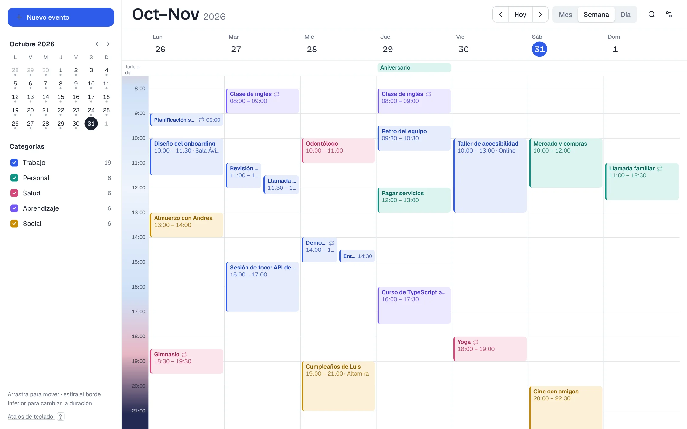
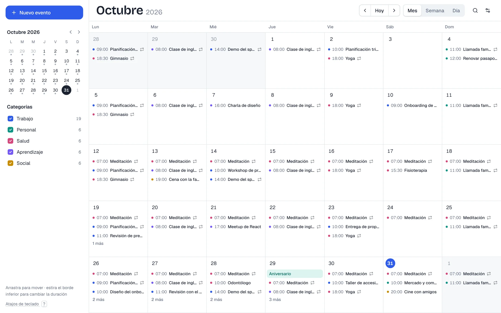
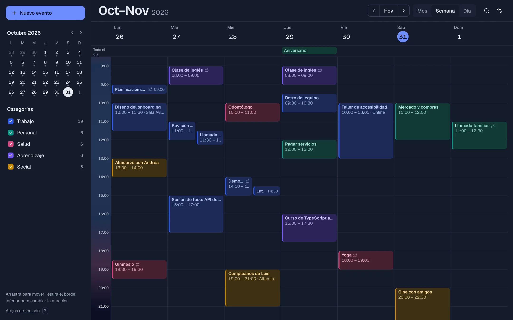
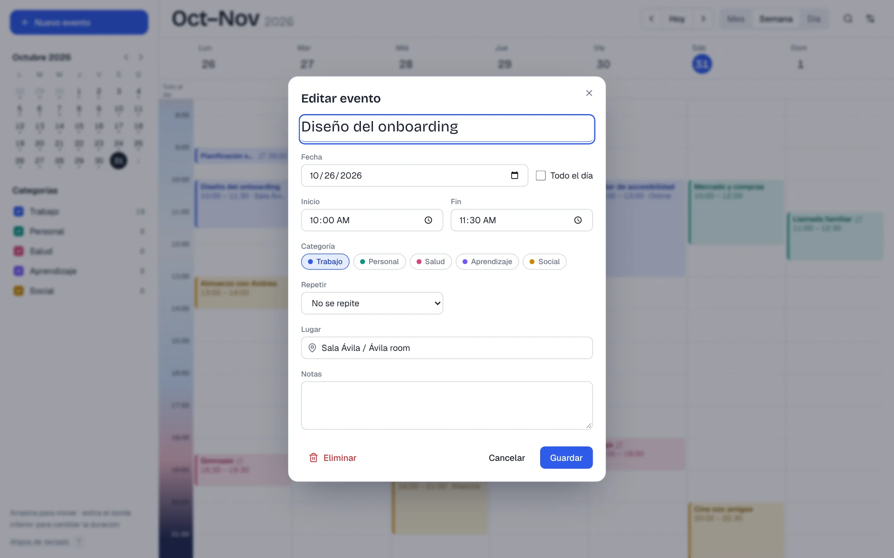
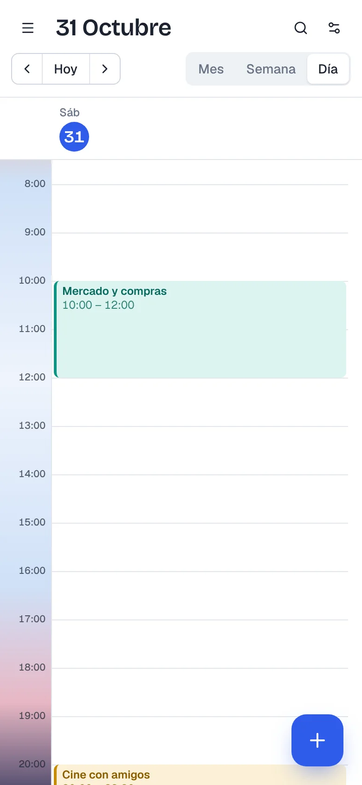

# Calendario

**[Español](#español) · [English](#english)**

> 🔗 **Demo:** [calendario-jtorres.vercel.app](https://calendario-jtorres.vercel.app) · Sin registro: los datos de ejemplo se guardan en tu navegador / No sign-up: sample data lives in your browser.



<table>
  <tr>
    <td width="50%"><br><sub><b>Mes</b> · arrastra eventos entre días / drag events between days</sub></td>
    <td width="50%"><br><sub><b>Modo oscuro</b> · claro, oscuro o según el sistema / light, dark or system</sub></td>
  </tr>
  <tr>
    <td><br><sub><b>Editar</b> · categorías, repetición, lugar y notas / categories, recurrence, place and notes</sub></td>
    <td align="center"><br><sub><b>Móvil</b> · vista día y botón para crear / day view and create button</sub></td>
  </tr>
</table>

---

## Español

Un calendario web completo, pensado para mostrar trabajo de frontend: interacción directa con el mouse o el dedo, lógica de fechas no trivial y una interfaz cuidada en claro, oscuro y móvil.

### Qué puedes hacer

- **Vistas de mes, semana y día**, con un mini calendario para saltar a cualquier fecha.
- **Arrastrar y soltar**: mueve eventos entre horas y días. En semana y día el bloque se ajusta de 15 en 15 minutos mientras lo arrastras.
- **Cambiar la duración** estirando el borde inferior del evento.
- **Crear arrastrando** sobre un espacio libre, o con un clic para un evento de una hora.
- **Eventos recurrentes** diarios, semanales o mensuales, con fecha de fin.
- **Eventos de todo el día** y de varios días.
- **Eventos que se solapan** se acomodan uno al lado del otro, como en Google Calendar.
- **Categorías con color** que se pueden ocultar o mostrar.
- **Búsqueda** por título, lugar o notas, sin importar tildes.
- **Atajos de teclado**: `T` hoy, `M` / `S` / `D` vistas, `←` `→` navegar, `N` nuevo, `/` buscar, `?` ayuda.
- **Exportar a .ics** para importarlo en Google Calendar, Outlook o Apple Calendar.
- **Español e inglés**, modo **claro, oscuro o del sistema**, y deshacer al eliminar.

### Detalles técnicos

- **Next.js 16** (App Router) · **React 19** · **TypeScript** · **Tailwind CSS 4**
- Componentes al estilo **shadcn/ui** sobre **Radix UI** (diálogos, menús), con foco visible y navegación por teclado.
- **@dnd-kit** para el arrastre, con movimiento ajustado a la grilla. El redimensionado y la creación por arrastre usan Pointer Events.
- **Zustand** con persistencia en `localStorage`. Si el almacenamiento está bloqueado (modo privado), la app sigue funcionando con datos de ejemplo.
- **date-fns** para fechas y localización. **Zod** para validar el formulario.

Lógica principal, separada de la interfaz y con tests:

| Archivo | Qué resuelve |
|---|---|
| [`src/lib/recurrence.ts`](src/lib/recurrence.ts) | Expande las series solo dentro del rango visible. Salta directo al rango en series largas y evita el desfase de las mensuales (31 → 28 → 31). |
| [`src/lib/layout.ts`](src/lib/layout.ts) | Reparte en columnas los eventos que se solapan, por grupos conectados. |
| [`src/lib/ics.ts`](src/lib/ics.ts) | Exporta a iCalendar (RFC 5545) con `RRULE` y escapes. |

### Tests

- **Unitarios (Vitest):** recurrencia, solapes y exportación .ics. Se corren con `pnpm test`.
- **De punta a punta (Playwright):** 17 interacciones reales: arrastrar, redimensionar, crear arrastrando, validar, deshacer, atajos, búsqueda, filtros, idioma y persistencia. Se corren con `pnpm e2e` mientras la app está levantada.

### Correr en local

```bash
pnpm install
pnpm dev        # http://localhost:3000
pnpm test       # tests unitarios
```

---

## English

A full-featured web calendar built as a frontend showcase: direct manipulation with mouse or touch, non-trivial date logic, and a polished UI in light, dark and mobile.

### Features

- **Month, week and day views**, plus a mini calendar to jump to any date.
- **Drag and drop**: move events across hours and days. In week and day view the block snaps to 15-minute steps while you drag.
- **Resize** an event by pulling its bottom edge.
- **Drag to create** on empty space, or click for a one-hour event.
- **Recurring events**: daily, weekly or monthly, with an end date.
- **All-day and multi-day events**.
- **Overlapping events** sit side by side, Google Calendar style.
- **Color-coded categories** you can show or hide.
- **Search** by title, place or notes, accent-insensitive.
- **Keyboard shortcuts**: `T` today, `M` / `W` / `D` views, `←` `→` navigate, `N` new, `/` search, `?` help.
- **Export to .ics** for Google Calendar, Outlook or Apple Calendar.
- **Spanish and English**, **light, dark or system** theme, and undo on delete.

### Under the hood

- **Next.js 16** (App Router) · **React 19** · **TypeScript** · **Tailwind CSS 4**
- **shadcn/ui-style** components on **Radix UI** (dialogs, menus), with visible focus and keyboard navigation.
- **@dnd-kit** for dragging, with grid-snapped movement. Resizing and drag-to-create use Pointer Events.
- **Zustand** persisted to `localStorage`. If storage is blocked (private mode), the app still runs on sample data.
- **date-fns** for dates and localization. **Zod** for form validation.

The core logic lives outside the UI and is unit tested: recurrence expansion ([`recurrence.ts`](src/lib/recurrence.ts)), overlap layout ([`layout.ts`](src/lib/layout.ts)) and iCalendar export ([`ics.ts`](src/lib/ics.ts)).

### Tests

- **Unit (Vitest):** recurrence, overlap layout and .ics export. Run with `pnpm test`.
- **End to end (Playwright):** 17 real interactions: drag, resize, drag-to-create, validation, undo, shortcuts, search, filters, language and persistence. Run with `pnpm e2e` while the app is running.

### Run locally

```bash
pnpm install
pnpm dev        # http://localhost:3000
pnpm test       # unit tests
```

---

Hecho por / Built by **Jose Torres** · [GitHub](https://github.com/xTorres97)
